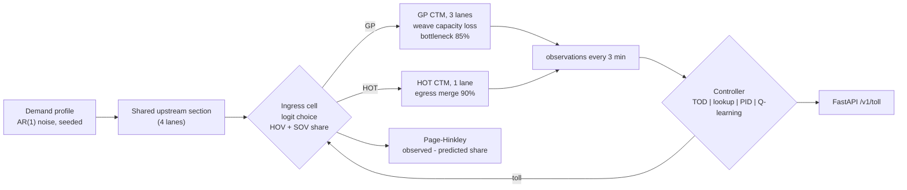
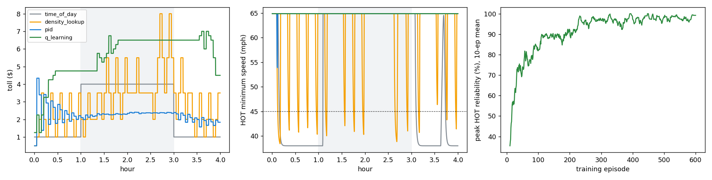

# dynamic-hot-pricing-controller

**Dynamic tolling for a freeway HOT lane, four controllers compared.** A two-facility cell
transmission model (3 GP lanes with a recurring bottleneck plus 1 HOT lane with an egress merge)
models weaving capacity loss at the ingress. Solo drivers choose with a logit model over a lognormal
value-of-time distribution, and HOVs ride free. Four pricing controllers are compared: a time-of-day
schedule, a MnPASS-style density lookup, a tuned PID and tabular Q-learning. All are evaluated on
held-out demand days, and a Page-Hinkley detector watches for shifts in willingness to pay.

**Headline (10 held-out days):** the tuned **PID** kept the HOT lane at ≥ 45 mph in **99%** of peak
intervals (time-of-day: 95%) while charging **40% less** ($2.38 vs $4.00). GP speeds rose from
**45.9 to 61.7 mph**. Q-learning took three iterations of state and reward design to reach 97% reliability,
and it still over-prices with high day-to-day variance.

---

## 1. Problem formulation

Managed lanes must hold a speed standard: 23 U.S.C. 166 requires HOV/HOT facilities to average at least
45 mph for 90% of the peak period. The toll is the only lever. Price too low and the HOT lane breaks down;
price too high and the GP lanes absorb the demand, the ingress weave grows, and revenue falls.

| Bar | Here |
|---|---|
| **Traffic engineering** | CTM corridor with lane drop, HOT egress merge, ingress weaving capacity loss, 45-mph reliability standard, GP impacts, revenue |
| **ML / control** | Velocity-form PID with anti-windup (tuned on training days), tabular Q-learning with documented state and reward iterations, logit choice over a VOT distribution, Page-Hinkley drift detection |
| **Systems** | Deterministic seeded episodes (0.25 s per 4-h day), train / tune / test seed separation, FastAPI toll endpoint serving the frozen Q-table or controller step |

---

## 2. Architecture



---

## 3. Methodology

**Traffic model.** CTM per lane: $v_f$ = 29 m/s, $w$ = 5.4 m/s, $k_j$ = 0.12 veh/m, so $q_{max}$ = 1,967 veh/h/ln;
400-m cells, 10-s steps (CFL holds). The GP bottleneck runs at 85% of capacity, and the HOT egress merge at 90%.
Ingress weaving: $c_{GP,ingress} \leftarrow c\,(1-\alpha f_{LC}/q_{max}N_{GP})$ with $\alpha$ = 0.6.

**Lane choice.** For each SOV with value of time $\nu\sim\text{LogN}(\ln 18, 0.6)$ \$/h:

$$P(\text{HOT})=\frac{1}{1+\exp\!\big(-[\,-\tau-\nu\,TT_{HOT}+\beta-(-\nu\,TT_{GP})\,]\big)},\quad \beta=\$0.30$$

using the *current* travel times (as posted on a sign), averaged over 512 VOT draws. HOVs (12%) always use the HOT lane.

**Controllers** (toll bounds \$0.50-\$10, update every 3 min):

* **Time-of-day**: \$1 shoulder, \$4 peak.
* **Density lookup**: toll steps at 0.5/0.7/0.85/0.95/1.05 × critical density (\$0.50 → \$8), one step per update.
* **PID (velocity form)**: $\Delta\tau = K_p(e_k-e_{k-1}) + K_ie_k + K_d(e_k-2e_{k-1}+e_{k-2})$ with
  $e=(k_{HOT}-k^*)/k_{crit}$. Gains and target are grid-searched on tuning days 500-504; the selected values were
  $K_p$ = 2, $K_i$ = 0.2, $k^*$ = 0.8 $k_{crit}$. Clamping the velocity form gives anti-windup.
* **Q-learning**: state = (HOT density bin, GP density bin, HOT trend, current toll bin); actions
  Δτ ∈ {−1, −0.25, 0, +0.25, +1}; reward = corridor throughput (k veh/h) − 20·[HOT < 45 mph] − 0.2|Δτ|;
  ε-greedy, 600 training days (0-599).

**Evaluation.** Held-out days 1001-1010, with the same days for every controller. The peak is hours 1-3.

**Drift.** On PID-controlled days, the value of time drops to 60% at hour 2. Page-Hinkley runs on
(observed − predicted) SOV share, with the operator's model assuming the original VOT distribution.

---

## 4. Results ([`results/hot_pricing/RESULTS.md`](results/hot_pricing/RESULTS.md))

| Metric (peak, mean of 10 days) | Time-of-day | Density lookup | **PID (tuned)** | Q-learning |
|---|---|---|---|---|
| HOT reliability (≥ 45 mph) | 95% | 93% | **99%** | 97% |
| HOT throughput (veh/h) | 1,407 | 1,404 | **1,536** | 1,223 ± 146 |
| GP throughput (veh/h) | 4,955 | 4,891 | 4,894 | 4,975 |
| GP mean speed (mph) | 45.9 | 50.0 | **61.7** | 47.5 ± 4.7 |
| Upstream queue (veh-h, 4 h) | 285 | 311 | 373 | 619 |
| Mean / max peak toll | \$4.00 / \$4.00 | \$4.11 / \$7.75 | **\$2.38** / \$4.34 | \$4.77 / \$6.25 |
| Toll changes per day | 2 | 67 | 79 | 31 |
| Revenue per 4-h period | **\$6,843** | \$5,726 | \$5,850 | \$4,404 |



**Engineering reading.**

* **Lower but responsive tolls beat a high flat toll.** The PID holds the HOT lane just under critical density
  with about \$2.38. The \$4 peak price pushes drivers back into the GP lanes (45.9 mph). The time-of-day plan
  earns the most revenue, which is a policy choice, not an operations win.
* **Lookup tables oscillate.** The MnPASS-style table steps between bins, producing a bang-bang toll with
  repeated short HOT breakdowns (middle panel). Smoothing the table or adding hysteresis is the usual remedy.
* **The \$1 shoulder toll breaks the lane down *outside* the peak** (grey trace): a peak-only reliability
  metric misses it.
* **Trade-off the PID does not win:** its upstream queue (373 veh-h) is higher than time-of-day's (285),
  because more demand reaches the ingress weave.

### The RL iterations

| Version | Change | Peak HOT reliability | What happened |
|---|---|---|---|
| v1 | state without current toll | 50% | Partially observed: incremental actions mean different things at \$1 and \$9; tolls hit the \$10 cap |
| v2 | + toll bin in state, breakdown penalty 5 | 37% | Learned to **under-price** (\$2.03): trading breakdowns for throughput was what the reward asked for |
| v3 | penalty 20 (matches the evaluation constraint) | **97%** | Meets the standard, but over-prices with high day-to-day variance |

Learning curve (right panel): reliability climbs from about 40% to above 95% within about 250 episodes.
**Conclusion:** on a problem with a clear target state, a tuned PID with two gains beats tabular RL. RL's
behaviour was dominated by state and reward design.

### Drift detection
VOT × 0.6 at hour 2: detected on **8 of 10** days, median delay **69 min**, **0 false alarms** over 20 days.
The delay is the price of the conservative threshold: the PID keeps compensating, which hides the residual.

---

## 5. Layout, reproduce, limitations

```
src/hotlane/model.py        CTM corridor, ingress choice, weaving, egress merge
src/hotlane/controllers.py  TOD, lookup, PID, Q-learning
src/hotlane/drift.py        Page-Hinkley
src/hotlane/study.py        training, PID tuning, evaluation, drift experiment
src/hotlane/api/app.py, cli.py, report.py ; tests/ (9 tests incl. vehicle conservation)
```

```bash
python -m venv .venv && .venv/Scripts/activate
pip install -r requirements.txt && pip install --no-deps -e .
pytest && hotlane study --episodes 600 && hotlane serve
```

**Limitations.** Single ingress and egress, no HOV-occupancy enforcement or violators, a static VOT
distribution within a day (except in the drift test), and a first-order traffic model (no capacity drop at
breakdown beyond the fixed bottlenecks). Choice parameters are illustrative, not estimated from toll transactions.

## License

MIT
