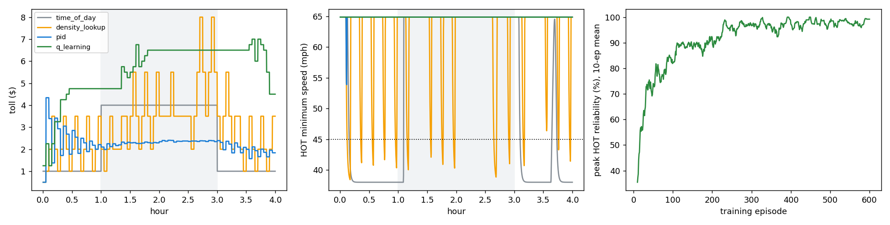

# HOT-lane pricing study

Q-learning trained for 600 episodes on seeds 0-599 (155 s); PID gains grid-searched on seeds 500-504 (selected Kp=2.0, Ki=0.2, target=0.8 x k_crit). All controllers evaluated on held-out seeds 1001-1010 (mean ± 95% CI).

| Metric | Time-of-day ($1 / $4) | Density lookup (MnPASS-style) | PID (tuned) | Q-learning (trained) |
|---|---|---|---|---|
| Peak HOT reliability (min speed >= 45 mph) | 95% ± 0 | 93% ± 1 | 99% ± 1 | 97% ± 2 |
| HOT throughput, peak (veh/h) | 1407 ± 20 | 1404 ± 35 | 1536 ± 12 | 1223 ± 146 |
| GP throughput, peak (veh/h) | 4955 ± 15 | 4891 ± 19 | 4894 ± 26 | 4975 ± 29 |
| GP mean speed, peak (mph) | 45.9 ± 0.9 | 50.0 ± 1.5 | 61.7 ± 0.4 | 47.5 ± 4.7 |
| Upstream queue (veh-h) | 285 ± 128 | 311 ± 143 | 373 ± 149 | 619 ± 366 |
| Mean peak toll ($) | 4.00 ± 0.00 | 4.11 ± 0.24 | 2.38 ± 0.05 | 4.77 ± 1.03 |
| Max toll ($) | 4.00 ± 0.00 | 7.75 ± 0.57 | 4.34 ± 0.01 | 6.25 ± 0.86 |
| Toll changes per day | 2 ± 0 | 67 ± 4 | 79 ± 0 | 31 ± 8 |
| Revenue per 4-h period ($) | 6,843 ± 176 | 5,726 ± 200 | 5,850 ± 141 | 4,404 ± 1,032 |
| Ingress weaving flow, peak (veh/h) | 1378 ± 20 | 1418 ± 32 | 1544 ± 12 | 1240 ± 149 |

## Drift detection (Page-Hinkley on observed - predicted HOT share, PID-controlled days)

VOT multiplied by 0.6 at hour 2.0: detected on 8/10 days, median delay 69 min; false alarms 0 over 20 days (shifted days alarming before the shift + unshifted days).

